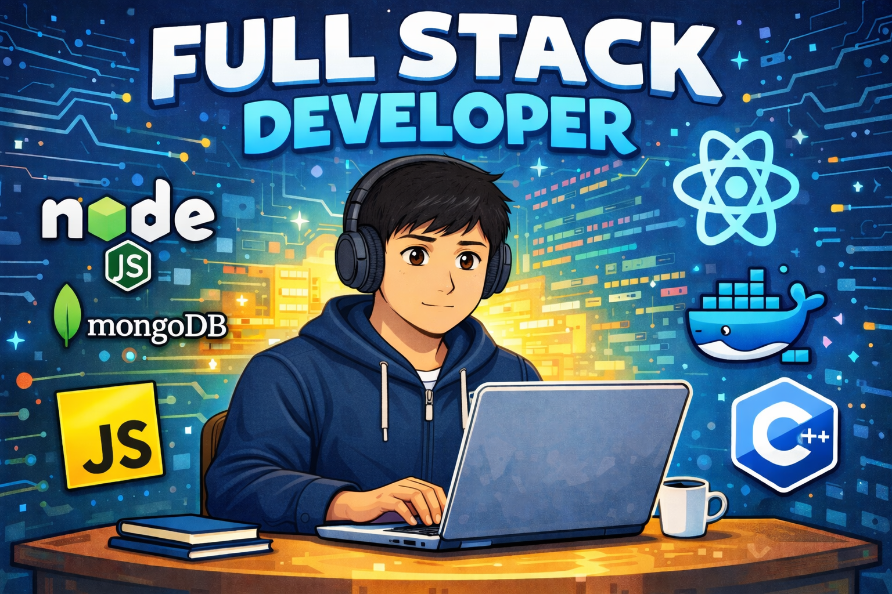

<!-- Banner -->

<!-- Typing Animation -->
<h1 align="center">
  
</h1>

<!-- Short Intro -->
<h3 align="center">🚀 Passionate about building scalable full-stack applications</h3>

---

### 🌟 About Me  
- 🔭 Currently looking for a Job. 
- 💬 Ask me about **Full Stack Development**  
- 📫 Reach me at **ranitbiswasofficial@gmail.com**

---

### 🌐 Coding Platform Profiles 

  <!--  -->
  <!--  -->
  <!--  -->
  
  

### ​🧰 Languages & Tools  
<!-- 

  

 -->

  
  
  
  
  
  
  
  
  
  
  
  
  
  
  
  
  
  
  
  
  
  
  
  
  
  

